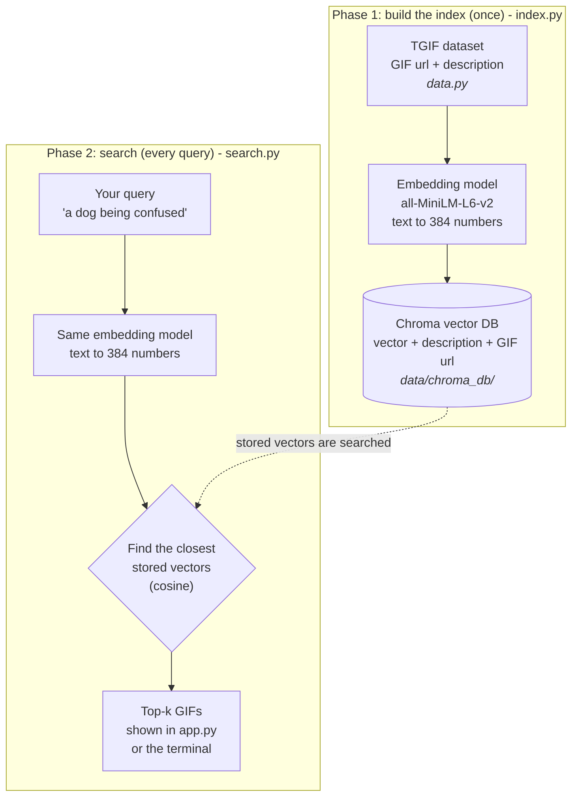

# GIF Search (semantic search PoC)

Type a sentence like *"a dog being confused"* and get matching GIFs. Small replica of the
[Pinecone GIF search article](https://www.pinecone.io/learn/gif-search/), using a **local Chroma DB**
instead of Pinecone, and a **5,000-GIF subset** of the TGIF dataset so it runs in minutes.


## gifly web interface

GIFt now includes a responsive browser interface for finding and saving GIFs. The same FastAPI server serves the frontend and the existing API routes.

### What changed

- Added a shuffled homepage with paginated browsing, GIF previews and copyable links.
- Unified GIF and video lookup in one search bar. GIF search selects its local ranking method automatically and prioritizes exact phrases in quotation marks.
- Added Like and Dislike controls to both the homepage and search results. Homepage likes suggest similar GIFs, and dislikes hide results until restored.
- Added local sign-up, sign-in and per-account favorites backed by SQLite. **Registration will receive further updates in a future iteration.**
- Integrated a background retrieval benchmark. Benchmark settings and reports are available through the developer tooling.
- Added video search and in-browser playback when the Gemini configuration, video files and index are available.

### Run locally

From the project root on Windows, prepare the full TGIF catalog and build the Chroma index:

```powershell
python -m venv .venv
.\.venv\Scripts\python.exe -m pip install -r requirements.txt
.\.venv\Scripts\python.exe -m web.prepare_tgif
.\start-web.ps1 -IndexData
```

Open http://127.0.0.1:8000. On later runs, start with `.\start-web.ps1`. The first setup downloads TGIF descriptions and the MiniLM model. GIF images load from their original URLs.

The app uses Chroma for local search and SQLite for accounts and favorites. For configuration, testing and optional video setup, see the [web guide](web/README.md). The CLI uses the original sample index if present and falls back to the full web index. Streamlit, video ingestion, and benchmarking have separate developer commands.

## Where to start
1. Read **How it works** below.
2. Do the setup steps, then run `notebooks/concepts.ipynb` to learn the ideas (about 20 minutes).
3. Build the index and try the app.
4. Read the code in order: `gift/data.py`, `gift/index.py`, `gift/search.py`, `apps/streamlit_app.py`.

## Prerequisites
- Python 3.10+ (developed on 3.13)
- ~2 GB disk (PyTorch + model), internet on first run (dataset ~18 MB, model ~90 MB)

## How it works

The project has two phases. Phase 1 runs once. Phase 2 runs on every search.



1. **Retriever**: `all-MiniLM-L6-v2` turns text into a vector. Similar meaning = close vectors.
2. **Vector DB**: Chroma stores vectors plus the GIF url and finds the nearest ones (cosine).
3. **Show**: GIFs are hot-linked from their original URLs.

The same model must be used in both phases. Otherwise the query vector and the stored vectors are not comparable.

## Files

| File | Job |
|------|-----|
| `gift/config.py` | All settings: paths, model names, batch size |
| `gift/data.py` | Download and load the TGIF dataset |
| `gift/index.py` | Encode descriptions, save to Chroma |
| `gift/search.py` | `search_gif(query, k)` |
| `gift/gemini/` | Gemini index and search, like/dislike feedback, webcam emotion |
| `gift/video/` | Video embedding and text-to-video search |
| `apps/streamlit_app.py` | Streamlit UI |
| `api.py` | FastAPI HTTP API (`uvicorn api:app`) and gifly website |
| `web/` | The gifly website (see [web guide](web/README.md)) |
| `benchmark/` | Retrieval benchmark |
| `notebooks/concepts.ipynb` | Start here: explains embeddings, similarity and vector DBs (no index needed) |
| `notebooks/gif_search.ipynb` | Step-by-step notebook on the real GIF data |
| `data/` | Generated, git-ignored: dataset (`tgif-v1.0.tsv`) and database (`chroma_db/`) |

```
.
├── gift/            the shared code
│   ├── config.py    settings
│   ├── data.py      step 1: data
│   ├── index.py     step 2: build index
│   ├── search.py    step 3: search
│   ├── gemini/      Gemini index, search, feedback, emotion
│   └── video/       video embedding and search
├── apps/            step 4: Streamlit app
├── api.py           HTTP API entry point
├── notebooks/       concepts.ipynb, gif_search.ipynb
└── data/            generated, not in git
    ├── tgif-v1.0.tsv
    └── chroma_db/
```

**Deprecated root files.** `config.py`, `data.py`, `search.py`, `index.py`, `gemini_index.py`, `gemini_search.py`, `feedback.py`, `emotion.py`, `video_search.py`, `app.py` and `ingestion/embed_videos.py` are one-line shims that point at the code in `gift/` and `apps/`. They keep old imports and commands working while branches catch up. Use the `gift.*` paths in new code. The shims will be deleted later.

## Step by step

### 1. Create and activate a virtual environment (PowerShell)
```powershell
python -m venv .venv
.venv\Scripts\Activate.ps1
```
macOS/Linux: `python3 -m venv .venv && source .venv/bin/activate`

### 2. Install dependencies
```powershell
pip install -r requirements.txt
```
Contributors: also run `pip install pre-commit; pre-commit install`. It blocks commits of files over 1 MB or anything under `data/` (CI checks the same on every PR).

### 3. Build the index
```powershell
python -m gift.index --limit 5000
```
This downloads the dataset to `data/`, encodes 5,000 random descriptions, and saves them to `data/chroma_db/`.
Takes ~1-2 minutes on CPU. Safe to re-run: it skips if the index already exists. Want more? Use a bigger `--limit` (full set is ~125k, much slower).

### 4. Try a search in the terminal
```powershell
python -m gift.search a dog being confused
```

### 5. Run the web app
```powershell
streamlit run apps/streamlit_app.py
```

### 6. Run the HTTP API
```bash
uvicorn api:app --host 127.0.0.1 --port 8000
```
Search with `curl "http://127.0.0.1:8000/search?q=a%20dog%20being%20confused&k=9"`.
Interactive API documentation is available at `http://127.0.0.1:8000/docs`.
The API serves the gifly interface at `/` and searches a local index. Build the sample index or use the prepared full web index.

### 7. Or run the notebooks
```powershell
python -m ipykernel install --user --name gif-search
jupyter notebook notebooks/
```
Open `concepts.ipynb` first, then `gif_search.ipynb` (needs step 3). Pick kernel `gif-search`. Run cells top to bottom (outputs are stripped in git).

### 8. Run the retrieval benchmark (optional)
```powershell
pip install -r requirements-benchmark.txt
python -m benchmark --help
```
Compares BM25, MiniLM, Qwen3, BGE-M3 and hybrid retrieval on a frozen 10,000-caption / 200-query split.
See [benchmark/README.md](benchmark/README.md) for the full guide.

## Example queries
- a dog being confused
- animals being cute
- a fluffy dog being cute and dancing like a person

## Troubleshooting
- **Broken images**: GIFs are hosted on Tumblr, some links are dead. Normal.
- **`ModuleNotFoundError` in a notebook** (for example `No module named 'chromadb'`): the notebook is using the wrong Python. Select the `.venv` kernel: in VS Code click **Select Kernel** (top right) and pick `.venv`; in Jupyter use **Kernel > Change kernel > gif-search** (see step 6).
- **"No GIF index found"**: run `python -m gift.index` first.
- **Want to re-index**: delete the `data/chroma_db/` folder and run `python -m gift.index` again.
- **Few results look right**: only 5,000 GIFs indexed. Raise `--limit`.

## Next steps

Pick one and build it as a team project. Every idea reuses `search_gif(query, k)` from `search.py`, so you only write the new "front door".

| Idea | What you build | Good to learn | Difficulty |
|------|----------------|---------------|------------|
| **REST API** | A [FastAPI](https://fastapi.tiangolo.com/) app with `GET /search?q=...&k=9` that returns the results as JSON | HTTP, JSON, API docs | Easy |
| **Discord bot** | A bot with a `/gif <description>` command that replies with the best GIF url (Discord shows the GIF inline) using [discord.py](https://discordpy.readthedocs.io/) | Bots, async code, tokens and secrets | Medium |
| **Deploy the web app** | Put `app.py` online with [Streamlit Community Cloud](https://streamlit.io/cloud) or [Hugging Face Spaces](https://huggingface.co/spaces). The index is not in git, so build it on startup or host it separately | Deployment, environment setup | Medium |
| **Custom web page** | A small React or plain HTML page that calls your REST API | Frontend, calling APIs | Medium |
| **Docker image** | A `Dockerfile` that installs the requirements and builds the index, so anyone can run the project with one command | Containers, reproducibility | Medium |
| **Better search** | Index the full 125k dataset, try a bigger embedding model, or add a "more like this" button | Search quality, evaluation | Medium to hard |

Tips for any of these:
- Never commit secrets (Discord tokens, API keys). Put them in environment variables or a `.env` file. `.env` is already git-ignored.
- The model takes a few seconds to load, so load it once when the program starts. `search.py` already does this.
- Free hosting has limited memory. The 5,000-GIF index is small enough. The full dataset may not be.

## Differences from the article
- Chroma (local, no API key) instead of Pinecone.
- Subset of data by default.
- Streamlit and notebook both included.

## Notes
Everything generated lives in `data/` and is git-ignored. Paths come from `config.py` and are relative to the repo, so scripts run from any folder.
